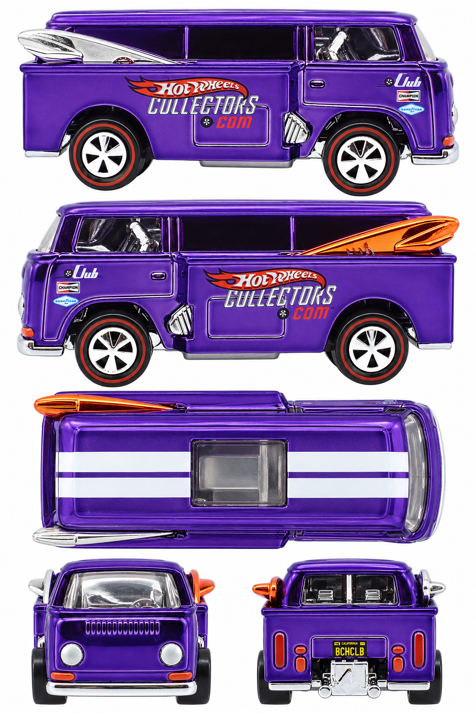

# Beach Bomb Too — purple RLC club car

**K3370 · 2006 RLC membership car, Spectraflame purple**

[Library](../../README.md) · [Gallery](../../index.html#beach-bomb-too-k3370) · [Manifest](manifest.json)

## Current multiview sheet

**Accepted · v2 · 1024 × 1536 PNG**

Both side profiles passed the level-camera review.

[Open sheet](generated/reference-sheet.png) · [Final exact prompt](generation.prompt.txt) · [Review](review.json)

Right profile facing right; left profile facing left; overhead facing right; front and rear below. Tripo multiview uses front, left, rear and right crops. The top view remains available for fitting and textures.

Generated directly from real photographs.

Right side: real reference. Left side: real reference. [Side evidence](reference/side-evidence.json).

- Complete sheet generated directly from four real original photos; no generated sheet input at any stage.
- Both side profiles independently pass level-camera review; white exterior backgrounds and photographic surface depth also pass.
- Both physical sides have real photos: silver board right, orange-chrome board left.
- No direct vertical top photograph: overhead geometry and hidden relief are synthesized from oblique photos.
- Tiny sponsor/plate characters and metallic reflections remain approximate.
- The small molded insert behind the left front wheel is silver in this sheet; the source photograph has an orange-chrome appearance there. Board color itself is correctly side-specific.
- Surface highlights are baked into RGB; this is not a neutral albedo map or measured geometry. No 3D reconstruction test performed.

## Original photographs

All 8 originals retain their source bytes. [Source URLs and checksums](reference/sources.json).

| File | Resolution | Type |
| --- | --- | --- |
| [catalog-01.jpg](reference/catalog-01.jpg) | 1804 × 1006 | loose-toy catalog photograph |
| [catalog-02.jpg](reference/catalog-02.jpg) | 1754 × 1032 | loose-toy catalog photograph |
| [catalog-03.jpg](reference/catalog-03.jpg) | 922 × 1160 | loose-toy catalog photograph |
| [catalog-04.jpg](reference/catalog-04.jpg) | 1770 × 1089 | loose-toy catalog photograph |
| [catalog-05.jpg](reference/catalog-05.jpg) | 1846 × 1049 | loose-toy catalog photograph |
| [catalog-06.jpg](reference/catalog-06.jpg) | 1046 × 1134 | loose-toy catalog photograph |
| [catalog-07.jpg](reference/catalog-07.jpg) | 1940 × 1141 | loose-toy catalog photograph |
| [pack-photo.webp](reference/pack-photo.webp) | 394 × 600 | user-supplied pack photo |

The folder contains only the current sheet, original photos, final prompt and current review. Follow the [reference workflow](../../workflow/README.md) for new cars.
