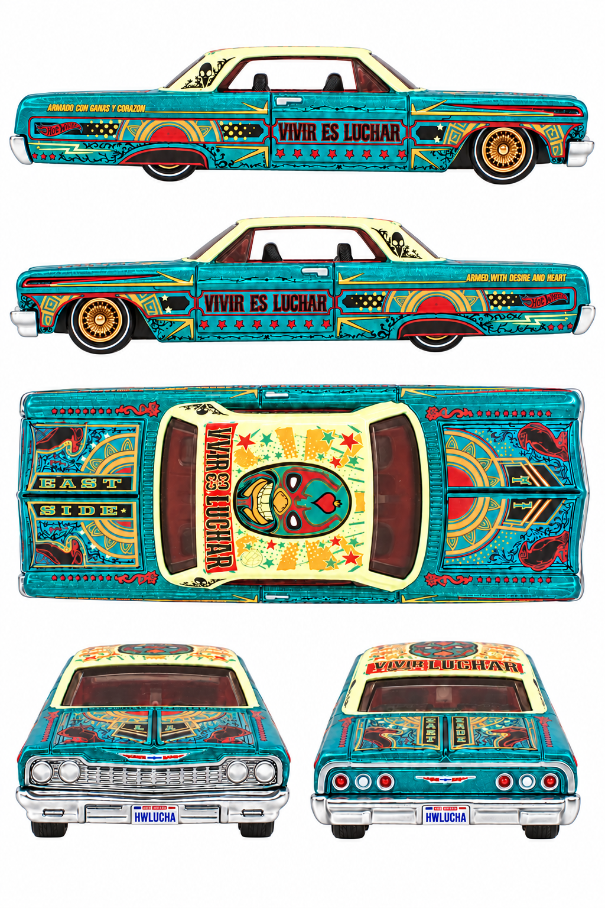

# 1964 Chevy Impala — Dallas dinner car

**JKB99 · 2026 26th Collectors Nationals, Dallas**

[Library](../../README.md) · [Gallery](../../index.html#chevy-impala-jkb99) · [Manifest](manifest.json)

## Current multiview sheet

**Accepted · v7 · 1024 × 1536 PNG**

Both side profiles passed the level-camera review.

[Open sheet](generated/reference-sheet.png) · [Final exact prompt](generation.prompt.txt) · [Review](review.json)

Right profile facing right; left profile facing left; overhead facing right; front and rear below. Tripo multiview uses front, left, rear and right crops. The top view remains available for fitting and textures.

Finalized by editing an earlier generated sheet. The final prompt and original photographs are retained; superseded working images were removed.

Right side: real reference. Left side: real reference. [Side evidence](reference/side-evidence.json).

- Both physical side profiles independently pass the strict level-camera visual check.
- Both physical sides have real exact-release photo evidence; generated reprojection remains synthetic.
- All five panels pass the visual check for a white background without external ground shadows.
- Right quarter has ARMADO CON GANAS Y CORAZON; left has ARMED WITH DESIRE AND HEART. Both doors keep VIVIR ES LUCHAR normally readable.
- EAST/SIDE trunk lettering orientation in the overhead remains inaccurate relative to the real photo; two focused correction attempts were rejected for worse results. Use the original trunk photo when authoring the final texture.
- Roof lettering and fine ornamentation remain approximated; front/rear panels retain elevated cameras.
- No numerical calibration or 3D reconstruction test.

## Original photographs

All 10 originals retain their source bytes. [Source URLs and checksums](reference/sources.json).

| File | Resolution | Type |
| --- | --- | --- |
| [pack-photo.webp](reference/pack-photo.webp) | 2343 × 3559 | user-saved-pack-photo |
| [catalog-01.jpg](reference/catalog-01.jpg) | 2125 × 777 | catalog-loose-car-photo |
| [catalog-02.jpg](reference/catalog-02.jpg) | 925 × 876 | catalog-loose-car-photo |
| [catalog-03.jpg](reference/catalog-03.jpg) | 2090 × 754 | catalog-loose-car-photo |
| [catalog-04.jpg](reference/catalog-04.jpg) | 934 × 898 | catalog-loose-car-photo |
| [catalog-05.jpg](reference/catalog-05.jpg) | 2090 × 901 | catalog-loose-car-photo |
| [catalog-06.jpg](reference/catalog-06.jpg) | 2355 × 1003 | catalog-loose-car-photo |
| [catalog-07.jpg](reference/catalog-07.jpg) | 2219 × 962 | catalog-loose-car-photo |
| [supporting/1964-Chevy-Impala-hot-wheels-2026-dinner-car.jpg](reference/supporting/1964-Chevy-Impala-hot-wheels-2026-dinner-car.jpg) | 549 × 800 | supporting-packaging-photo |
| [supporting/1964-Chevy-Impala-dinner-car.jpg](reference/supporting/1964-Chevy-Impala-dinner-car.jpg) | 503 × 800 | supporting-packaging-photo |

The folder contains only the current sheet, original photos, final prompt and current review. Follow the [reference workflow](../../workflow/README.md) for new cars.
