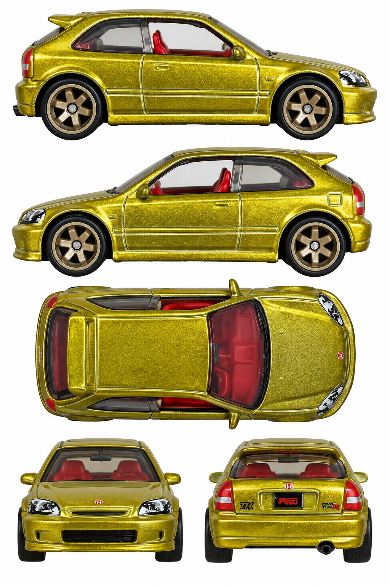

# '99 Honda Civic Type R (EK9) — gold Super Treasure Hunt

**HCY12 · 2022 Super Treasure Hunt, HW Hatchbacks 5/5, 125/250**

[Library](../../README.md) · [Gallery](../../index.html#civic-type-r-hcy12) · [Manifest](manifest.json)

## Current multiview sheet

**Draft — correction needed · v2 · 1024 × 1536 PNG**

This sheet is a draft. It has not passed the side-camera review and must not be treated as an accepted input.

[Open sheet](generated/draft-sheet.png) · [Final exact prompt](generation.prompt.txt) · [Review](review.json)

Right profile facing right; left profile facing left; overhead facing right; front and rear below. Tripo multiview uses front, left, rear and right crops. The top view remains available for fitting and textures.

Generated directly from real photographs.

Right side: real reference. Left side: real reference. [Side evidence](reference/side-evidence.json).

- Both profiles still expose broad hood/cowl top planes and front headlamp faces.
- Both sides have real seller photographs; several originals are 700px and were preserved without artificial upscaling.
- Gold material, red cabin, left fuel flap and right exhaust are represented; fine rear logos remain approximations.
- True vertical top photo unavailable; overhead is inferred from elevated real photos.
- Fine printing, reflections and reconstructed geometry are approximate, not a neutral albedo map or calibrated CAD.
- No 3D reconstruction test was performed for this sheet.

## Original photographs

All 8 originals retain their source bytes. [Source URLs and checksums](reference/sources.json).

| File | Resolution | Type |
| --- | --- | --- |
| [ebay-01.webp](reference/ebay-01.webp) | 1600 × 1600 | seller loose-toy photograph |
| [ebay-02.webp](reference/ebay-02.webp) | 700 × 700 | seller loose-toy photograph |
| [ebay-03.webp](reference/ebay-03.webp) | 700 × 700 | seller loose-toy photograph |
| [ebay-04.webp](reference/ebay-04.webp) | 700 × 700 | seller loose-toy photograph |
| [ebay-05.webp](reference/ebay-05.webp) | 700 × 700 | seller loose-toy photograph |
| [ebay-06.webp](reference/ebay-06.webp) | 700 × 700 | seller loose-toy photograph |
| [ebay-07.webp](reference/ebay-07.webp) | 700 × 700 | seller loose-toy photograph |
| [pack-photo.png](reference/pack-photo.png) | 395 × 600 | user-supplied pack photo |

The folder contains only the current sheet, original photos, final prompt and current review. Follow the [reference workflow](../../workflow/README.md) for new cars.
