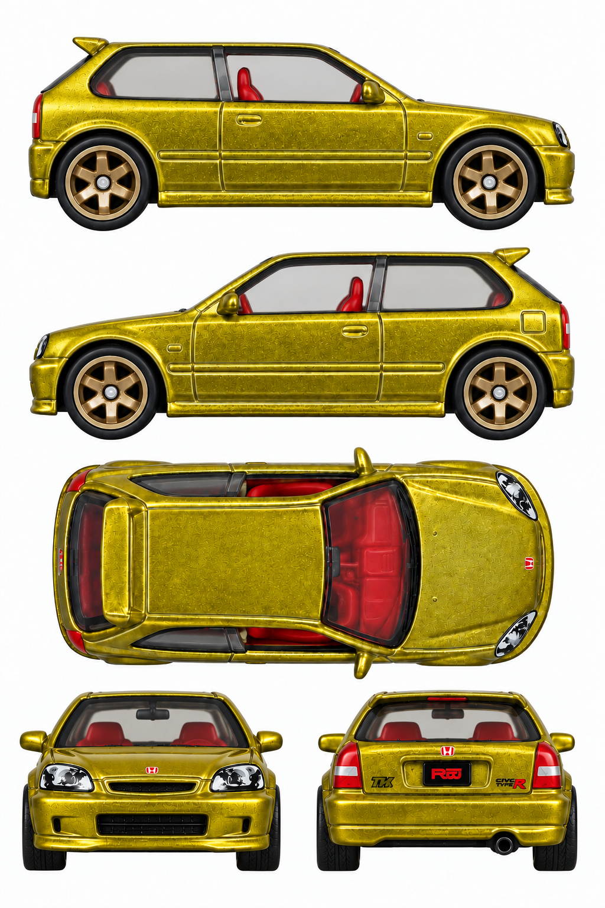

# '99 Honda Civic Type R (EK9) — gold Super Treasure Hunt

**HCY12 · 2022 Super Treasure Hunt, HW Hatchbacks 5/5, 125/250**

[Library](../../README.md) · [Gallery](../../index.html#civic-type-r-hcy12) · [Manifest](manifest.json)

## Current multiview sheet

**Accepted · v3 · 1024 × 1536 PNG**

Both side profiles passed the level-camera review.

[Open sheet](generated/reference-sheet.png) · [Final exact prompt](generation.prompt.txt) · [Review](review.json)

Right profile facing right; left profile facing left; overhead facing right; front and rear below. Tripo multiview uses front, left, rear and right crops. The top view remains available for fitting and textures.

Finalized by editing an earlier generated sheet. The final prompt and original photographs are retained; superseded working images were removed.

Right side: real reference. Left side: real reference. [Side evidence](reference/side-evidence.json).

- Both physical sides independently pass the strict level-camera visual checks. This is visual acceptance, not numerical calibration.
- Gold EK9, six-spoke wheels, red cabin and left-only fuel flap retained. Rear Ryu plate and small printed badges are synthesized.
- Noticeable swirled/engraved-looking gold microtexture is a generation artifact, not observed paint decoration. Do not transfer it literally into albedo or normal maps.
- Front/rear cameras were lowered, but still are not numerically calibrated.
- Fine lettering, reflections and reconstructed dimensions remain synthetic approximations, not calibrated CAD or an exact albedo map.
- True overhead geometry is partly inferred from elevated photographs.
- No Tripo reconstruction or numerical camera calibration was performed in this correction task.

## Original photographs

All 8 originals retain their source bytes. [Source URLs and checksums](reference/sources.json).

| File | Resolution | Type |
| --- | --- | --- |
| [ebay-01.webp](reference/ebay-01.webp) | 1600 × 1600 | seller loose-toy photograph |
| [ebay-02.webp](reference/ebay-02.webp) | 700 × 700 | seller loose-toy photograph |
| [ebay-03.webp](reference/ebay-03.webp) | 700 × 700 | seller loose-toy photograph |
| [ebay-04.webp](reference/ebay-04.webp) | 700 × 700 | seller loose-toy photograph |
| [ebay-05.webp](reference/ebay-05.webp) | 700 × 700 | seller loose-toy photograph |
| [ebay-06.webp](reference/ebay-06.webp) | 700 × 700 | seller loose-toy photograph |
| [ebay-07.webp](reference/ebay-07.webp) | 700 × 700 | seller loose-toy photograph |
| [pack-photo.png](reference/pack-photo.png) | 395 × 600 | user-supplied pack photo |

The folder contains only the current sheet, original photos, final prompt and current review. Follow the [reference workflow](../../workflow/README.md) for new cars.
