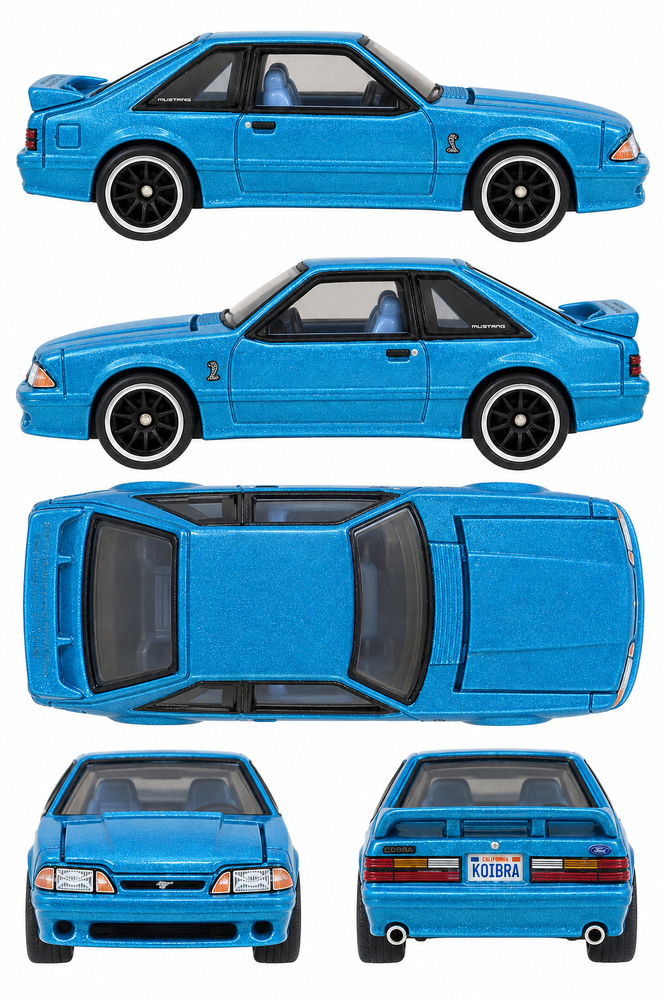

# 1993 Ford Mustang Cobra R — turquoise Nationals dinner car

**HGK61 · 2022 Charlotte 22nd Collectors Nationals dinner car**

[Library](../../README.md) · [Gallery](../../index.html#mustang-cobra-r-hgk61) · [Manifest](manifest.json)

## Current multiview sheet

**Draft — correction needed · v2 · 1024 × 1536 PNG**

This sheet is a draft. It has not passed the side-camera review and must not be treated as an accepted input.

[Open sheet](generated/draft-sheet.png) · [Final exact prompt](generation.prompt.txt) · [Review](review.json)

Right profile facing right; left profile facing left; overhead facing right; front and rear below. Tripo multiview uses front, left, rear and right crops. The top view remains available for fitting and textures.

Generated directly from real photographs.

Right side: real reference. Left side: real reference. [Side evidence](reference/side-evidence.json).

- Both profile rows expose broad hood/cowl and spoiler top surfaces; bottom front/rear cameras remain elevated.
- The hood rear edge remains raised rather than sitting fully flush.
- Fine convention/spoiler lettering is unreliable; v3 invents an incorrect event inscription.
- True vertical top photo unavailable; overhead is inferred from elevated real photos.
- Fine printing, reflections and reconstructed geometry are approximate, not a neutral albedo map or calibrated CAD.
- No 3D reconstruction test was performed for this sheet.

## Original photographs

All 7 originals retain their source bytes. [Source URLs and checksums](reference/sources.json).

| File | Resolution | Type |
| --- | --- | --- |
| [catalog-01.jpg](reference/catalog-01.jpg) | 1769 × 806 | loose-toy catalog photograph |
| [catalog-02.jpg](reference/catalog-02.jpg) | 785 × 954 | loose-toy catalog photograph |
| [catalog-03.jpg](reference/catalog-03.jpg) | 821 × 1004 | loose-toy catalog photograph |
| [catalog-04.jpg](reference/catalog-04.jpg) | 1808 × 908 | loose-toy catalog photograph |
| [catalog-05.jpg](reference/catalog-05.jpg) | 831 × 925 | loose-toy catalog photograph |
| [catalog-06.jpg](reference/catalog-06.jpg) | 2058 × 909 | loose-toy catalog photograph |
| [pack-photo.png](reference/pack-photo.png) | 389 × 600 | user-supplied pack photo |

The folder contains only the current sheet, original photos, final prompt and current review. Follow the [reference workflow](../../workflow/README.md) for new cars.
