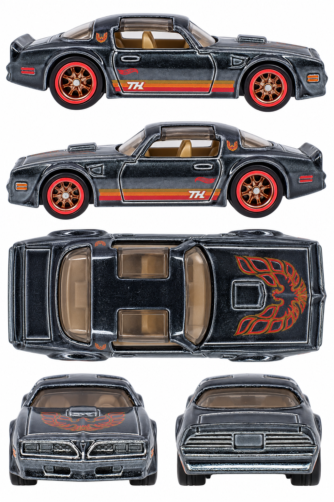

# '77 Pontiac Firebird T/A — black Super Treasure Hunt

**HTF40 · 2024 Super Treasure Hunt, Muscle Mania 4/5, 206/250**

[Library](../../README.md) · [Gallery](../../index.html#pontiac-firebird-htf40) · [Manifest](manifest.json)

## Current multiview sheet

**Draft — correction needed · v3 · 1024 × 1536 PNG**

This sheet is a draft. It has not passed the side-camera review and must not be treated as an accepted input.

[Open sheet](generated/draft-sheet.png) · [Final exact prompt](generation.prompt.txt) · [Review](review.json)

Right profile facing right; left profile facing left; overhead facing right; front and rear below. Tripo multiview uses front, left, rear and right crops. The top view remains available for fitting and textures.

Generated directly from real photographs.

Right side: real reference. Left side: real reference. [Side evidence](reference/side-evidence.json).

- All three attempts generated directly from four real photographs; no generated sheet used as input.
- Both side rows fail the strict camera gate: broad hood and rear-deck top planes remain visible.
- Front and rear panels also retain elevated cameras.
- Overhead geometry is synthesized; exposed wheel-face projections may not be consistent with a true vertical view.
- Tiny logos/lettering and exact textures are generative approximations.

## Original photographs

All 6 originals retain their source bytes. [Source URLs and checksums](reference/sources.json).

| File | Resolution | Type |
| --- | --- | --- |
| [catalog-01.jpg](reference/catalog-01.jpg) | 2073 × 884 | loose-toy catalog photograph |
| [catalog-02.jpg](reference/catalog-02.jpg) | 993 × 1055 | loose-toy catalog photograph |
| [catalog-03.jpg](reference/catalog-03.jpg) | 2003 × 872 | loose-toy catalog photograph |
| [catalog-04.jpg](reference/catalog-04.jpg) | 964 × 881 | loose-toy catalog photograph |
| [catalog-05.jpg](reference/catalog-05.jpg) | 2224 × 1028 | loose-toy catalog photograph |
| [pack-photo.png](reference/pack-photo.png) | 397 × 600 | user-supplied pack photo |

The folder contains only the current sheet, original photos, final prompt and current review. Follow the [reference workflow](../../workflow/README.md) for new cars.
