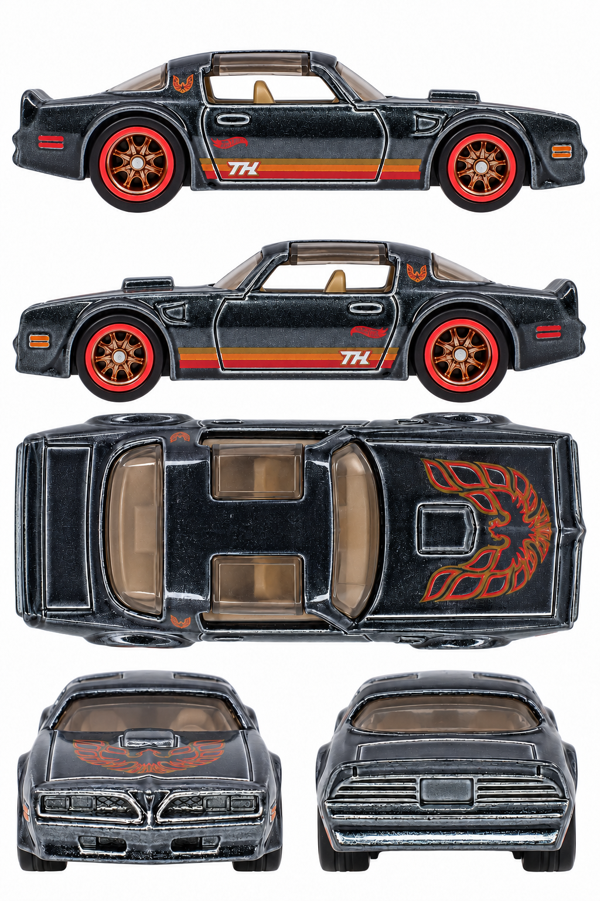

# '77 Pontiac Firebird T/A — black Super Treasure Hunt

**HTF40 · 2024 Super Treasure Hunt, Muscle Mania 4/5, 206/250**

[Library](../../README.md) · [Gallery](../../index.html#pontiac-firebird-htf40) · [Manifest](manifest.json)

## Current multiview sheet

**Accepted · v4 · 1024 × 1536 PNG**

Both side profiles passed the level-camera review.

[Open sheet](generated/reference-sheet.png) · [Final exact prompt](generation.prompt.txt) · [Review](review.json)

Right profile facing right; left profile facing left; overhead facing right; front and rear below. Tripo multiview uses front, left, rear and right crops. The top view remains available for fitting and textures.

Finalized by editing an earlier generated sheet. The final prompt and original photographs are retained; superseded working images were removed.

Right side: real reference. Left side: real reference. [Side evidence](reference/side-evidence.json).

- Both physical sides independently pass the strict level-camera visual checks. This is visual acceptance, not numerical calibration.
- Black metallic HTF40, tan cabin/T-tops, bronze wheels with red rims, lower stripes and pillar birds retained; rear lamp relief remains metallic/chrome.
- Tiny TH/flame marks and hood phoenix are approximations; use source photos for exact printing.
- Front and rear views still show broad upper surfaces. Overhead projection and wheel-edge visibility are approximate.
- Fine lettering, reflections and reconstructed dimensions remain synthetic approximations, not calibrated CAD or an exact albedo map.
- True overhead geometry is partly inferred from elevated photographs.
- No Tripo reconstruction or numerical camera calibration was performed in this correction task.

## Original photographs

All 6 originals retain their source bytes. [Source URLs and checksums](reference/sources.json).

| File | Resolution | Type |
| --- | --- | --- |
| [catalog-01.jpg](reference/catalog-01.jpg) | 2073 × 884 | loose-toy catalog photograph |
| [catalog-02.jpg](reference/catalog-02.jpg) | 993 × 1055 | loose-toy catalog photograph |
| [catalog-03.jpg](reference/catalog-03.jpg) | 2003 × 872 | loose-toy catalog photograph |
| [catalog-04.jpg](reference/catalog-04.jpg) | 964 × 881 | loose-toy catalog photograph |
| [catalog-05.jpg](reference/catalog-05.jpg) | 2224 × 1028 | loose-toy catalog photograph |
| [pack-photo.png](reference/pack-photo.png) | 397 × 600 | user-supplied pack photo |

The folder contains only the current sheet, original photos, final prompt and current review. Follow the [reference workflow](../../workflow/README.md) for new cars.
