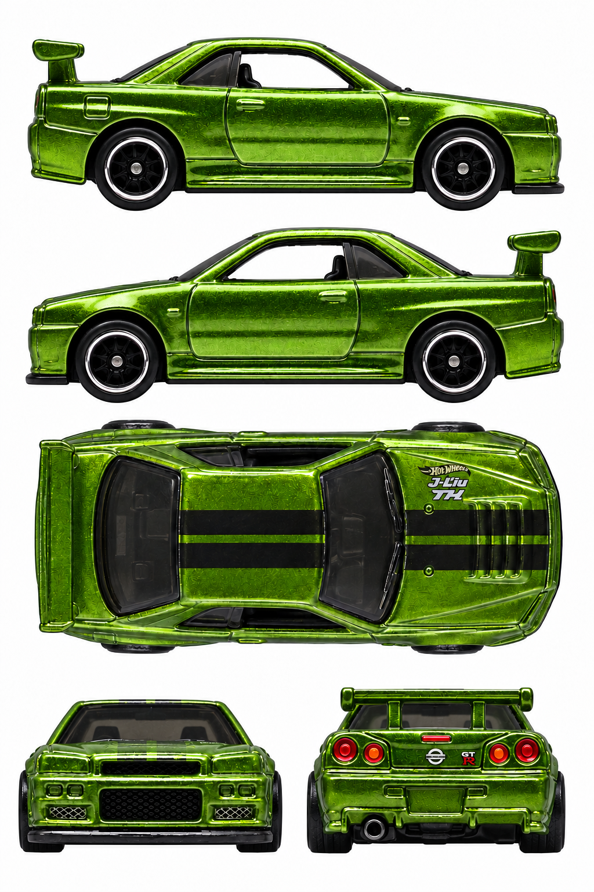

# Nissan Skyline GT-R (BNR34) — green Super Treasure Hunt

**FYG14 · 2019 Super Treasure Hunt, Nissan 2/5, 45/250**

[Library](../../README.md) · [Gallery](../../index.html#skyline-fyg14) · [Manifest](manifest.json)

## Current multiview sheet

**Accepted · v3 · 1024 × 1536 PNG**

Both side profiles passed the level-camera review.

[Open sheet](generated/reference-sheet.png) · [Final exact prompt](generation.prompt.txt) · [Review](review.json)

Right profile facing right; left profile facing left; overhead facing right; front and rear below. Tripo multiview uses front, left, rear and right crops. The top view remains available for fitting and textures.

Finalized by editing an earlier generated sheet. The final prompt and original photographs are retained; superseded working images were removed.

Right side: real reference. Left side: real reference. [Side evidence](reference/side-evidence.json).

- Both physical sides independently pass the strict level-camera visual checks. This is visual acceptance, not numerical calibration.
- Green FYG14, black/chrome wheels, plain flanks and wing, right-only fuel flap and left rear exhaust preserved.
- Synthetic swirled green paint grain remains; it is not a real decorative texture and should not be baked literally into albedo/normal maps.
- Front/rear were lowered but remain approximate projections; overhead is inferred.
- Fine lettering, reflections and reconstructed dimensions remain synthetic approximations, not calibrated CAD or an exact albedo map.
- True overhead geometry is partly inferred from elevated photographs.
- No Tripo reconstruction or numerical camera calibration was performed in this correction task.

## Original photographs

All 10 originals retain their source bytes. [Source URLs and checksums](reference/sources.json).

| File | Resolution | Type |
| --- | --- | --- |
| [pack-photo.png](reference/pack-photo.png) | 2328 × 3542 | user-supplied-pack-photo |
| [lamley-01.jpg](reference/lamley-01.jpg) | 6000 × 2849 | original-loose-toy-photo |
| [lamley-02.jpg](reference/lamley-02.jpg) | 5603 × 2712 | original-loose-toy-photo |
| [lamley-03.jpg](reference/lamley-03.jpg) | 5987 × 2689 | original-loose-toy-photo |
| [lamley-04.jpg](reference/lamley-04.jpg) | 6000 × 2972 | original-loose-toy-photo |
| [lamley-05.jpg](reference/lamley-05.jpg) | 5646 × 2548 | original-loose-toy-photo |
| [lamley-06.jpg](reference/lamley-06.jpg) | 5813 × 2536 | original-loose-toy-photo |
| [ebay-04.webp](reference/ebay-04.webp) | 1200 × 1185 | original-loose-toy-photo |
| [ebay-05.webp](reference/ebay-05.webp) | 1200 × 1153 | original-loose-toy-photo |
| [ebay-07.webp](reference/ebay-07.webp) | 1200 × 1167 | original-loose-toy-photo |

The folder contains only the current sheet, original photos, final prompt and current review. Follow the [reference workflow](../../workflow/README.md) for new cars.
