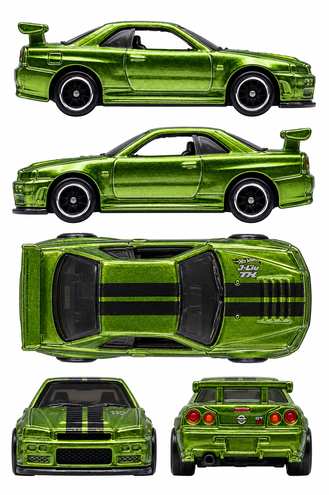

# Nissan Skyline GT-R (BNR34) — green Super Treasure Hunt

**FYG14 · 2019 Super Treasure Hunt, Nissan 2/5, 45/250**

[Library](../../README.md) · [Gallery](../../index.html#skyline-fyg14) · [Manifest](manifest.json)

## Current multiview sheet

**Draft — correction needed · v2 · 1024 × 1536 PNG**

This sheet is a draft. It has not passed the side-camera review and must not be treated as an accepted input.

[Open sheet](generated/draft-sheet.png) · [Final exact prompt](generation.prompt.txt) · [Review](review.json)

Right profile facing right; left profile facing left; overhead facing right; front and rear below. Tripo multiview uses front, left, rear and right crops. The top view remains available for fitting and textures.

Generated directly from real photographs.

Right side: real reference. Left side: real reference. [Side evidence](reference/side-evidence.json).

- Generated directly from five real original photos; no previous generated input.
- Both real sides documented; retained draft preserves right-only fuel flap.
- Both side rows retain visible front-bumper faces and fail the strict perpendicular-camera requirement.
- The bottom front view shows a broad hood surface; it is not accepted as a strict level frontal projection.
- No complete vertical overhead source: top projection and concealed relief are inferred from real oblique photos; visible hood/roof markings are documented.
- Tiny hood/rear logo geometry, lettering orientation and reflections are approximate, not an exact texture transfer.
- This is synthetic photographic reference with baked lighting, not calibrated CAD or neutral albedo. No Tripo submission or 3D reconstruction test was performed.

## Original photographs

All 10 originals retain their source bytes. [Source URLs and checksums](reference/sources.json).

| File | Resolution | Type |
| --- | --- | --- |
| [pack-photo.png](reference/pack-photo.png) | 2328 × 3542 | user-supplied-pack-photo |
| [lamley-01.jpg](reference/lamley-01.jpg) | 6000 × 2849 | original-loose-toy-photo |
| [lamley-02.jpg](reference/lamley-02.jpg) | 5603 × 2712 | original-loose-toy-photo |
| [lamley-03.jpg](reference/lamley-03.jpg) | 5987 × 2689 | original-loose-toy-photo |
| [lamley-04.jpg](reference/lamley-04.jpg) | 6000 × 2972 | original-loose-toy-photo |
| [lamley-05.jpg](reference/lamley-05.jpg) | 5646 × 2548 | original-loose-toy-photo |
| [lamley-06.jpg](reference/lamley-06.jpg) | 5813 × 2536 | original-loose-toy-photo |
| [ebay-04.webp](reference/ebay-04.webp) | 1200 × 1185 | original-loose-toy-photo |
| [ebay-05.webp](reference/ebay-05.webp) | 1200 × 1153 | original-loose-toy-photo |
| [ebay-07.webp](reference/ebay-07.webp) | 1200 × 1167 | original-loose-toy-photo |

The folder contains only the current sheet, original photos, final prompt and current review. Follow the [reference workflow](../../workflow/README.md) for new cars.
