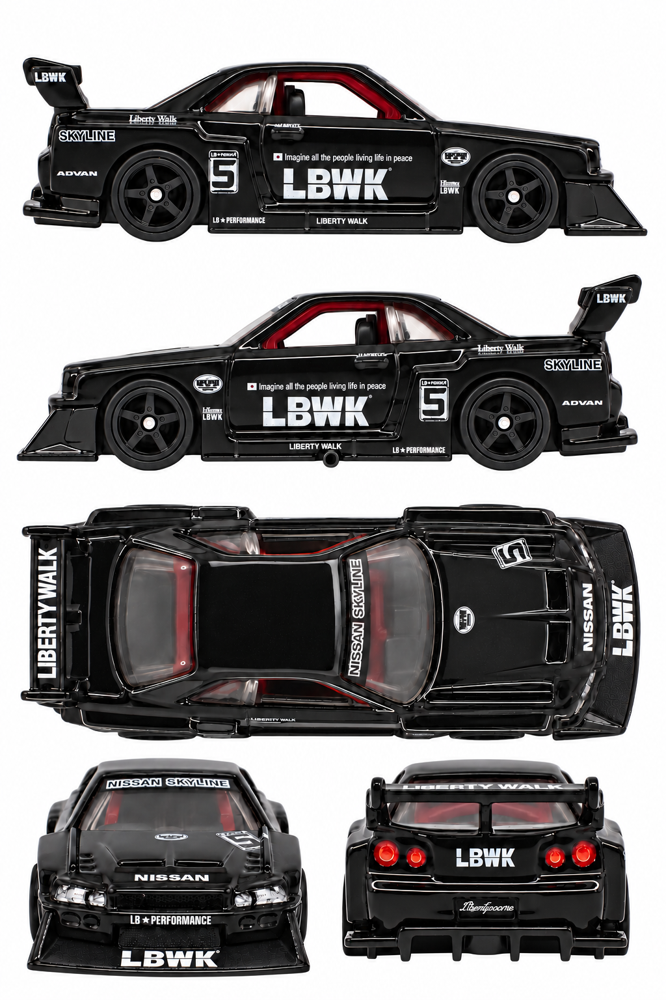

# LB-ER34 Super Silhouette Nissan Skyline

**HCK01 · 2022 Mountain Drifters 0/5 chase**

[Library](../../README.md) · [Gallery](../../index.html#skyline-hck01) · [Manifest](manifest.json)

## Current multiview sheet

**Accepted · v6 · 1024 × 1536 PNG**

Both side profiles passed the level-camera review.

[Open sheet](generated/reference-sheet.png) · [Final exact prompt](generation.prompt.txt) · [Review](review.json)

Right profile facing right; left profile facing left; overhead facing right; front and rear below. Tripo multiview uses front, left, rear and right crops. The top view remains available for fitting and textures.

Finalized by editing an earlier generated sheet. The final prompt and original photographs are retained; superseded working images were removed.

Right side: real reference. Left side: real reference. [Side evidence](reference/side-evidence.json).

- Both physical side profiles independently pass the strict level-camera visual check.
- Both physical sides have real exact-release photo evidence; generated reprojection remains synthetic.
- All five panels pass the visual check for a white background without external ground shadows.
- LBWK and numeral 5 read normally on both sides; small sill exhaust appears only in the left profile, matching its real photo.
- Fine sponsor lettering, exact decal scale/rotation and highlights remain synthesized approximations.
- Front/rear retain some camera elevation; no numerical calibration or 3D reconstruction test.

## Original photographs

All 13 originals retain their source bytes. [Source URLs and checksums](reference/sources.json).

| File | Resolution | Type |
| --- | --- | --- |
| [pack-photo.webp](reference/pack-photo.webp) | 2905 × 3554 | user-saved-pack-photo |
| [catalog-01.jpg](reference/catalog-01.jpg) | 2134 × 947 | catalog-loose-car-photo |
| [catalog-02.jpg](reference/catalog-02.jpg) | 908 × 1154 | catalog-loose-car-photo |
| [catalog-03.jpg](reference/catalog-03.jpg) | 2151 × 963 | catalog-loose-car-photo |
| [catalog-04.jpg](reference/catalog-04.jpg) | 978 × 924 | catalog-loose-car-photo |
| [catalog-05.jpg](reference/catalog-05.jpg) | 2106 × 943 | catalog-loose-car-photo |
| [supporting/LB-ER34-Super-Silhouette-Nissan-Skyline-Chase-Base.jpg](reference/supporting/LB-ER34-Super-Silhouette-Nissan-Skyline-Chase-Base.jpg) | 750 × 659 | supporting-car-or-packaging-photo |
| [supporting/LB-ER34-Super-Silhouette-Nissan-Skyline-Chase-Back-768x746.jpg](reference/supporting/LB-ER34-Super-Silhouette-Nissan-Skyline-Chase-Back-768x746.jpg) | 768 × 746 | supporting-car-or-packaging-photo |
| [supporting/LB-ER34-Super-Silhouette-Nissan-Skyline-Chase-Card-768x873.jpg](reference/supporting/LB-ER34-Super-Silhouette-Nissan-Skyline-Chase-Card-768x873.jpg) | 768 × 873 | supporting-car-or-packaging-photo |
| [supporting/LB-ER34-Super-Silhouette-Nissan-Skyline-Chase-1.jpg](reference/supporting/LB-ER34-Super-Silhouette-Nissan-Skyline-Chase-1.jpg) | 558 × 335 | supporting-car-or-packaging-photo |
| [supporting/LB-ER34-Super-Silhouette-Nissan-Skyline-Chase-2.jpg](reference/supporting/LB-ER34-Super-Silhouette-Nissan-Skyline-Chase-2.jpg) | 566 × 293 | supporting-car-or-packaging-photo |
| [supporting/LB-ER34-Super-Silhouette-Nissan-Skyline-Chase-3-768x532.jpg](reference/supporting/LB-ER34-Super-Silhouette-Nissan-Skyline-Chase-3-768x532.jpg) | 768 × 532 | supporting-car-or-packaging-photo |
| [supporting/LB-ER34-Super-Silhouette-Nissan-Skyline-Chase-Top.jpg](reference/supporting/LB-ER34-Super-Silhouette-Nissan-Skyline-Chase-Top.jpg) | 750 × 689 | supporting-car-or-packaging-photo |

The folder contains only the current sheet, original photos, final prompt and current review. Follow the [reference workflow](../../workflow/README.md) for new cars.
