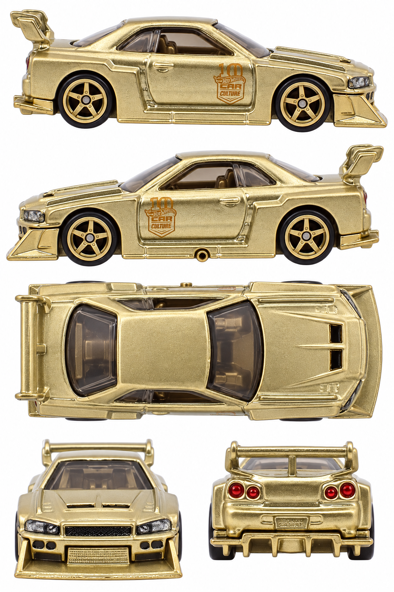

# LB-ER34 Super Silhouette Nissan Skyline — gold chase

**JKF36 · 2026 Car Culture Aérostyles 0/5 chase**

[Library](../../README.md) · [Gallery](../../index.html#skyline-jkf36) · [Manifest](manifest.json)

## Current multiview sheet

**Draft — correction needed · v2 · 1024 × 1536 PNG**

This sheet is a draft. It has not passed the side-camera review and must not be treated as an accepted input.

[Open sheet](generated/draft-sheet.png) · [Final exact prompt](generation.prompt.txt) · [Review](review.json)

Right profile facing right; left profile facing left; overhead facing right; front and rear below. Tripo multiview uses front, left, rear and right crops. The top view remains available for fitting and textures.

Generated directly from real photographs.

Right side: real reference. Left side: real reference. [Side evidence](reference/side-evidence.json).

- Both sides still reveal front headlight faces, hood upper planes and offset wing supports.
- Left-side sill exhaust is supported by real photos; v2 correctly locates it on the upper edge of the nose-right overhead.
- Door badge printing, hood relief and wing geometry remain synthetic approximations.
- True vertical top photo unavailable; overhead is inferred from elevated real photos.
- Fine printing, reflections and reconstructed geometry are approximate, not a neutral albedo map or calibrated CAD.
- No 3D reconstruction test was performed for this sheet.

## Original photographs

All 6 originals retain their source bytes. [Source URLs and checksums](reference/sources.json).

| File | Resolution | Type |
| --- | --- | --- |
| [catalog-01.jpg](reference/catalog-01.jpg) | 1868 × 863 | loose-toy catalog photograph |
| [catalog-02.jpg](reference/catalog-02.jpg) | 799 × 1045 | loose-toy catalog photograph |
| [catalog-03.jpg](reference/catalog-03.jpg) | 1851 × 887 | loose-toy catalog photograph |
| [catalog-04.jpg](reference/catalog-04.jpg) | 837 × 833 | loose-toy catalog photograph |
| [catalog-05.jpg](reference/catalog-05.jpg) | 1952 × 891 | loose-toy catalog photograph |
| [pack-photo.png](reference/pack-photo.png) | 487 × 600 | user-supplied pack photo |

The folder contains only the current sheet, original photos, final prompt and current review. Follow the [reference workflow](../../workflow/README.md) for new cars.
